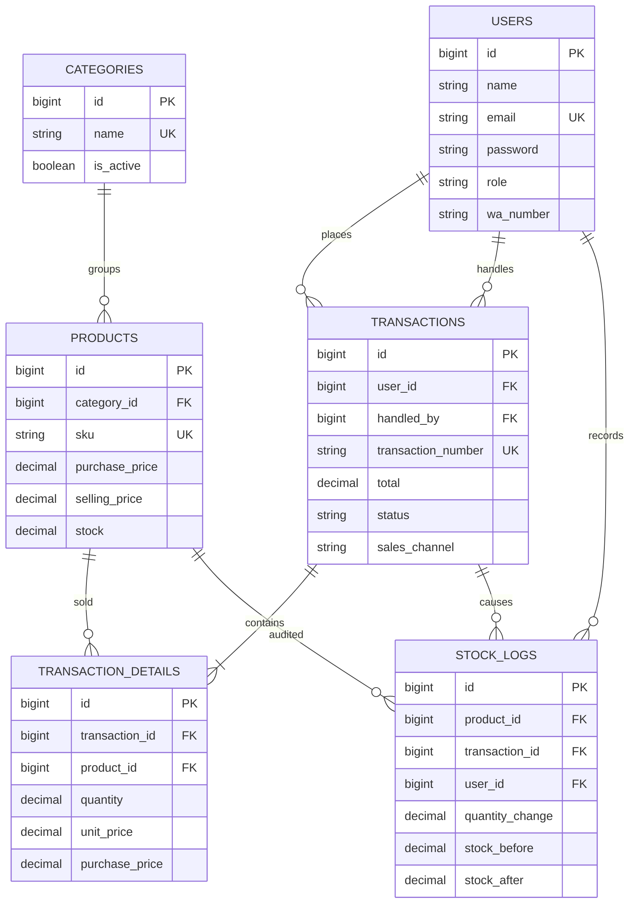

# ERD Toko Silaturizky

The Laravel application stores orders in `transactions` and their lines in
`transaction_details`. The SQL bootstrap also exposes simple `orders` and
`order_items` views for tools that use the POS-oriented names.

Product stock is decimal to support fractional units. Product deletion is soft-delete
so historical order lines and stock audits retain their product reference.
